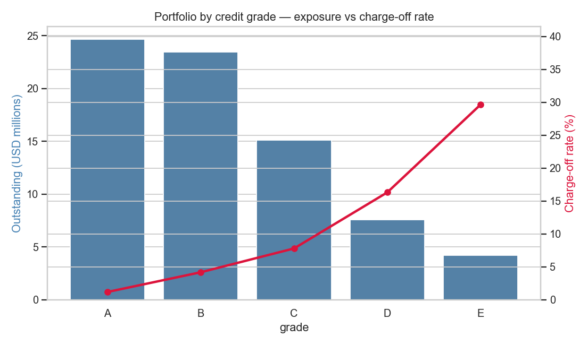
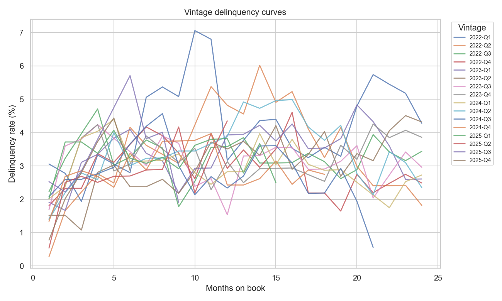
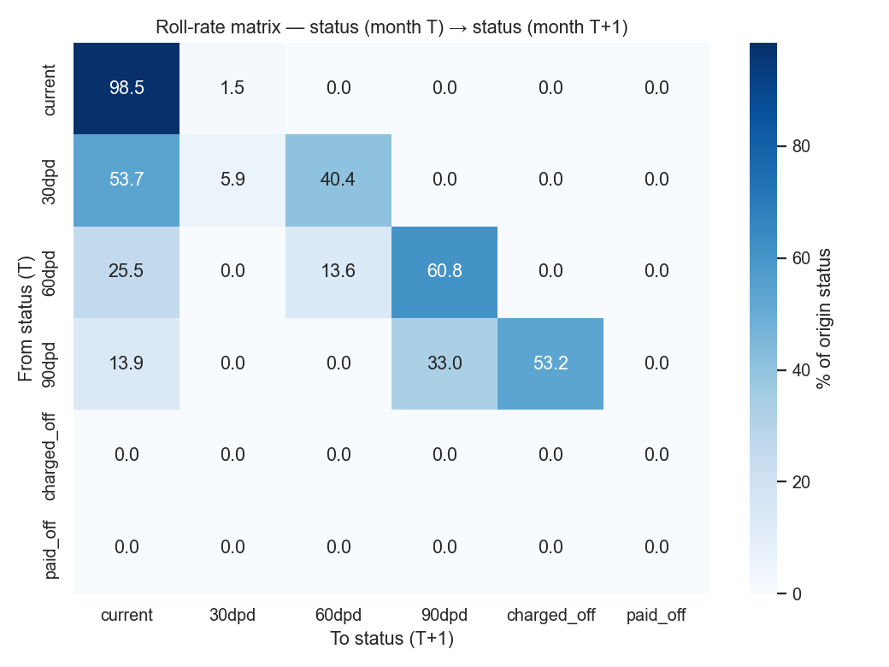

# Loan Portfolio SQL Analytics

A **SQL-first** project that builds the standard credit-portfolio reporting
pack every retail / consumer-lending shop maintains: portfolio summary by
grade, **vintage delinquency curves**, **roll-rate (status migration) matrix**,
**concentration risk** by exposure decile, and **first-payment default** by
underwriting cohort.

> **Why SQL-first.** 90% of data-analyst job postings in banking ask for
> advanced SQL — window functions, CTEs, NTILE, conditional aggregation.
> This repo demonstrates every one of those on a problem the credit team
> actually cares about.

---

## Tech stack

`SQL` — written in **PostgreSQL-compatible** syntax, runs unchanged in **SQLite**
so anyone can clone and execute without setting up a server.

A thin Python runner (`pandas`, `matplotlib`) executes the files, writes the
CSV outputs and renders three plots.

## Dataset

Generated by `src/generate_data.py`:

| Table | Rows | What it contains |
| --- | ---: | --- |
| `loans` | 8,000 | Origination snapshot — grade, purpose, amount, rate, term |
| `payments` | 182,078 | Monthly performance row per loan-month with status (`current`, `30dpd`, `60dpd`, `90dpd`, `charged_off`, `paid_off`) |

Snapshot date: **2026-04-01**. Originations cover **2022-Q1 through 2025-Q4**.

---

## SQL files (read these in order)

| File | Demonstrates | Output |
| --- | --- | --- |
| `sql/01_schema.sql` | Table DDL + indexes | — |
| `sql/02_portfolio_summary.sql` | CTE + `latest-status-per-loan` pattern + weighted-average rate | [`02_portfolio_summary.csv`](outputs/02_portfolio_summary.csv) |
| `sql/03_vintage_curve.sql` | Cohort dating from `origination_date` + grouped reporting on a long table | [`03_vintage_curve.csv`](outputs/03_vintage_curve.csv) |
| `sql/04_status_migration.sql` | `LAG()` window function + `SUM() OVER (PARTITION BY …)` for row-share | [`04_status_migration.csv`](outputs/04_status_migration.csv) |
| `sql/05_concentration_risk.sql` | `NTILE()` for deciles + scalar subquery for total share | [`05_concentration_risk.csv`](outputs/05_concentration_risk.csv) |
| `sql/06_first_payment_default.sql` | Multi-table CTE join + `HAVING COUNT(*) >= 50` filter for stat-significance | [`06_first_payment_default.csv`](outputs/06_first_payment_default.csv) |

---

## Headline results

### Portfolio by grade

| grade | n_loans | originated $M | outstanding $M | wavg_rate % | charge-off % |
| --- | ---: | ---: | ---: | ---: | ---: |
| A | 2,411 | 33.5 | 24.6 |  6.49 |  1.16 |
| B | 2,380 | 32.5 | 23.5 |  9.00 |  4.16 |
| C | 1,799 | 20.9 | 15.1 | 12.45 |  7.78 |
| D |   938 | 10.2 |  7.6 | 17.03 | 16.31 |
| E |   472 |  5.6 |  4.2 | 23.02 | **29.66** |



Risk-based pricing is doing its job (rates climb with grade), but E-grade is
charging off at 30% — the new-business team should expect this segment to
require active scrutiny.

### Vintage delinquency curves



The classic credit-team chart: every origination quarter has its own line.
Newer vintages run higher in months 6–18 — a leading indicator of either
underwriting drift or worsening macro conditions.

### Roll-rate matrix



Reading the matrix: of all loans in **`30dpd` in month T**, **54%** cure back
to `current` next month, **40%** roll to `60dpd`. The bigger the diagonal of
"deteriorating" cells, the worse the portfolio is doing.

### Concentration risk

The **top decile** of loans holds **29%** of outstanding balance, with a
charge-off rate of **7.75%** — i.e. roughly one in twelve of the biggest loans
ends up written off. This is the table the credit-risk committee asks for.

### First-payment default (worst grade × purpose combos)

| grade | purpose | loans | FPD events | FPD rate % |
| --- | --- | ---: | ---: | ---: |
| E | auto | 76 | 19 | **25.0** |
| E | debt_consolidation | 146 | 36 | 24.7 |
| E | credit_card | 62 | 10 | 16.1 |
| E | home_improvement | 71 | 11 | 15.5 |
| D | debt_consolidation | 321 | 43 | 13.4 |

FPD ≥ 10% is the classic red flag — half of the C/D/E grade × purpose buckets
breach it, which is the action item for credit policy review.

---

## How to run

### From scratch

```bash
pip install -r requirements.txt
python src/generate_data.py       # builds data/portfolio.db + CSVs
python src/run_queries.py         # executes every sql/*.sql, writes outputs/
```

### From PostgreSQL

```bash
psql -d portfolio -f sql/01_schema.sql
psql -d portfolio -c "\copy loans FROM 'data/loans.csv' CSV HEADER"
psql -d portfolio -c "\copy payments FROM 'data/payments.csv' CSV HEADER"
psql -d portfolio -f sql/02_portfolio_summary.sql
# ... and so on
```

The SQL files use no SQLite- or PostgreSQL-only syntax beyond `strftime()` in
the vintage query — easily swappable for `EXTRACT(YEAR FROM …)` / `DATE_TRUNC()`.

---

## Repository structure

```
04-loan-portfolio-sql-analytics/
├── README.md
├── requirements.txt
├── data/
│   ├── loans.csv
│   └── payments.csv
├── sql/
│   ├── 01_schema.sql
│   ├── 02_portfolio_summary.sql
│   ├── 03_vintage_curve.sql
│   ├── 04_status_migration.sql
│   ├── 05_concentration_risk.sql
│   └── 06_first_payment_default.sql
├── src/
│   ├── generate_data.py
│   └── run_queries.py
└── outputs/
    ├── portfolio_summary.png
    ├── vintage_curves.png
    ├── migration_matrix.png
    └── 02_..06_*.csv
```

---

**Author** — Juan Jacobo Mena García · Economist, junior data analyst
[LinkedIn](https://www.linkedin.com/in/jacobomena-data/) · jacobomena103@gmail.com
